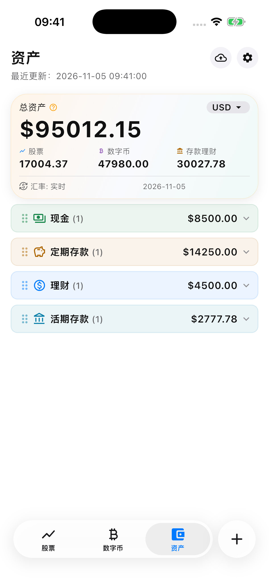
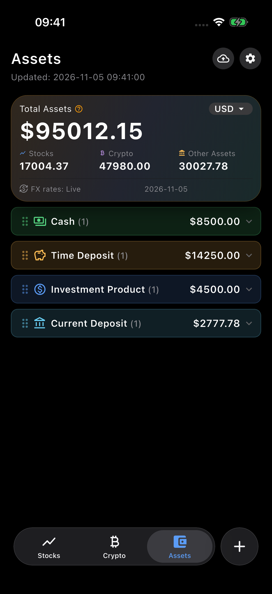

# 资产分类

在「资产」页面点底部「添加」，可选择已有分类、新建自定义分类，或从通用、美国、香港、中国大陆模板中添加分类。现金、活期、定期和理财是各地区通用分类；公积金只在中国大陆默认显示。模板弹窗按设备地区默认选择对应地区，也可在下拉菜单中切换。通用模板仅有房产和其他资产；美国仅有 401(k) / IRA，香港仅有强积金，中国大陆仅有公积金。切换地区时不会混入通用模板。已添加的旧分类仍会保留；非中国大陆设备上已有的公积金资产仍可查看和编辑。

地区菜单从选择框下方向下展开，宽度与选择框一致，并适配浅色和深色主题。分类底部弹窗使用当前窗口的可用宽度，支持 iPad 横竖屏和分屏变化。

分类决定资产在页面和资产分布中的显示位置；估值方式决定金额如何计算。自定义分类创建时可选择当前余额、本金加利息或份额乘净值。分类名称随后可以修改，已有资产的估值方式和金额不会因此改变。

在分类选择页的「⋯」菜单中可重命名分类，空的非内置分类可移除。拖动资产卡片，或在卡片操作列表选择「修改分类」，可将现有资产移到使用相同填写模板的分类。「修改分类」打开选择列表，仅显示其他同模板分类；取消不修改记录。余额类（现金、活期、公积金等）之间可以移动，定期和份额 × 净值类仅能移到各自同模板分类；不同模板会提示并阻止移动。移动后图标与配色采用目标分类样式，金额、币种和记录标识保留；保存失败会提示且保留原记录。卡片操作列表包含适用的「本息转存」和「修改分类」；没有其他同模板分类时不显示「修改分类」，「自动转存」开关仅在定期新增、编辑和转存表单中显示；卡片没有任何可用操作时不显示操作按钮。旧资产仍归入原分类，无需手动迁移。分类和排序随设置进入备份与 iCloud 同步；免费版最多使用 3 个有资产的分类，每类最多 3 条资产。

## 定期本息转存

点击已到期定期存款卡片的操作按钮会先显示操作列表，点击列表中的「本息转存」后打开转存表单。新本金默认填入该笔定期的估算本息，起存日默认填原到期日，利率和期限沿用原值并可修改。年利率与期限默认并排，起存日独占一行；窄屏或大字体时按需换行，日期控件缩放适配。可把新本金改为银行实际到期金额；币种保持不变。

确认后，新存期参数替换当前资产记录的旧参数，保留记录标识、分类、排序及创建时间，更新修改时间；资产列表仍只计入这一笔持有，不重复累计原存款。取消不修改数据；本地保存成功后才更新卡片，保存失败会提示并可重试。转存属于现有记录更新，不因已有资产超过免费额度而阻止。

默认本息仍按现有「本金 × 年利率 × 月数 ÷ 12」估算，不自动采用银行的实际天数/360 等计息方式。转存前请核对银行实际到期金额并修正新本金。

| iPhone 17 Pro · 简体中文 · 浅色 | iPhone 17 Pro · English · Dark |
| --- | --- |
|  |  |

## 自动转存

「自动转存」仅在定期新增、编辑及本息转存表单中设置，旧记录默认关闭。卡片保留金额在左、详情在右的布局。右侧依次显示年利率、到期日期与「自动转存」标记、剩余天数三行，字号按可用宽度等比缩小，每行不再拆行。操作列表只显示适用的「本息转存」和「修改分类」，没有可用操作时隐藏「⋯」按钮。

卡片金额仍按现有口径显示当前存期的预计到期本息。开启后，App 在到期当天按本地日历将当期估算本息作为下一期本金，沿用利率、月数、币种、分类及记录标识。到期日按目标月份计算，月份没有对应日期时使用当月最后一天；下一期从实际到期日开始计算。错过多期时逐期补算；重复刷新不会重复计息。关闭开关后不再计算后续转存，已完成的转存保留。

App 开着时按到期日触发检查，回到前台、重新打开、刷新及读取资产时也会检查。App 未运行时无法保证在到期时刻执行，下一次运行时补算；不会向银行发起任何交易。读写在本进程内串行，自动转存保存使用本地原子替换，成功后才提供新金额给页面或小组件。失败保留原文件并允许重试；无效参数或金额溢出不会写入，仍可关闭自动转存并修正记录。备份与 iCloud 数据包含开关及新的存期参数，多设备实际同步仍需验收。

自动转存仍使用现有月数估算公式，未模拟银行的实际天数、逐期舍入或变化的续存利率。银行利率、金额或续存安排变化时，应编辑当前记录或关闭开关并按实际情况修正。
