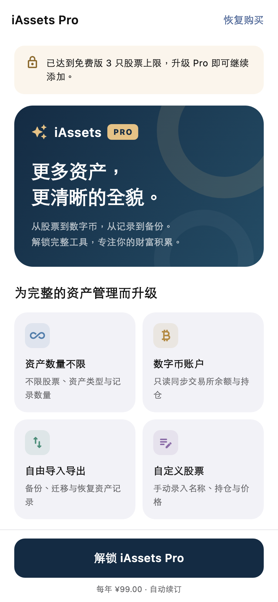
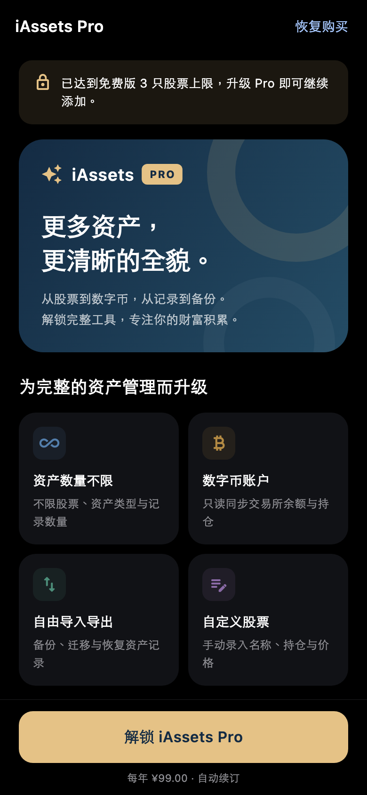

# Pro 使用与开发说明（2.0.0）

最低支持 iOS 16。App 只在中国大陆以外的地区上架，具体可下载地区以 App Store 配置和当地要求为准。

## 免费版与 Pro

| 功能 | 免费版 | Pro |
| --- | --- | --- |
| 股票 | 最多 3 只，所有市场合计 | 不限数量 |
| 手动资产类型（资产页分类卡片） | 最多 3 种 | 不限数量 |
| 每种类型的资产记录 | 最多 3 条 | 不限数量 |
| 数字币账户查看与同步 | 不可用 | 可用，仍仅支持只读查询 |
| 手动导入、导出及备份回滚 | 不可用 | 可用 |
| 自定义股票 | 不可用 | 可用 |
| iCloud 自动同步 | 可用 | 可用 |

免费版达到上限后，再次添加会显示对应原因和 Pro 购买页；数字币、导入导出和自定义股票入口也会引导购买。购买页提供权益介绍、月付、年付和买断方案、恢复购买、管理订阅、隐私政策与 Apple 标准 EULA，支持简体中文、繁体中文、英文及深浅主题。

以下为使用演示商品数据生成的界面预览，示例价格不代表商店商品已经配置或真实付款已经验证。

| 浅色 | 深色 |
| --- | --- |
|  |  |

订阅到期不删除或截断既有股票和手动资产，超额记录仍可查看、编辑和删除；继续添加时重新检查数量限制。已有自定义股票保留展示，相关操作需要 Pro。数字币连接配置保留，但免费状态不读取凭证、不查询账户、不展示余额或计入总资产。购买权益不会写入导出备份，导入数据不能解锁 Pro。

## 商品与价格

| 方案 | Product ID | App Store 类型 | 人民币参考定价 |
| --- | --- | --- | --- |
| 月付 | `org.bitlap.assets.pro.monthly` | 自动续期订阅，1 个月 | ¥10 |
| 年付 | `org.bitlap.assets.pro.yearly` | 自动续期订阅，1 年 | ¥99 |
| 买断 | `org.bitlap.assets.pro.lifetime` | 非消耗型内购 | ¥299 |

三个方案权益相同。月付和年付配置在同一订阅组、同一等级；价格需要在 App Store Connect 中设置，应用直接显示 Apple 返回的当地价格。参考定价不表示在中国大陆发行，实际价格以当地商店可选价格点为准。

年付为购买页默认选择。买断一次付款、不自动续期；已订阅用户购买买断后，原订阅不会自动取消，需通过“管理订阅”自行处理。已验证的永久 Pro 用户不会再次看到购买方案。

## 老用户永久 Pro

`PRO_LEGACY_CUTOFF` 是首次引入收费版本的固定 UTC 分界时间，随构建通过 `--dart-define` 传入。Apple 验证通过的生产环境 `AppTransaction.originalPurchaseDate` 早于该时间时，用户自动获得永久 Pro；等于或晚于该时间按新用户处理。

例如，若首次收费版本于北京时间 2026 年 11 月 1 日 00:00 发布，对应配置如下。这只是格式与时区示例，必须替换为实际发布分界时间：

```dotenv
PRO_LEGACY_CUTOFF="2026-10-31T16:00:00Z"
```

分界时间一经发布必须永久保持不变，后续版本不能按各自发布日期重设。换机、重装后使用同一个 Apple 账户恢复验证；不要用本地记录、安装日期、设置或导入备份作为老用户证明。沙盒的模拟获取日期不授予老用户永久权益。

首次获取信息无法验证时禁用购买并提示恢复验证，避免误向老用户收费。中国区下架不保证已安装用户仍能更新、重新下载或购买，应用内老用户规则不能绕过商店地区限制。

## 实现与配置

- [`ProService`](../lib/services/pro_service.dart)：权益状态、免费数量限制、商品加载、购买恢复及到期刷新。
- [`AppDelegate.swift`](../ios/Runner/AppDelegate.swift)：原生 StoreKit 2 商品、签名交易及首次获取日期验证，通过 `org.bitlap.assets/pro` 通道与 Flutter 通信。
- [`Pro 购买页`](../lib/widgets/pro/pro_page.dart)：按受限原因展示权益和方案，使用商店返回的价格。
- [`发布指南`](../scripts/README.md#pro-发布配置)：商品创建、环境变量及构建上传步骤。

StoreKit 在设备端验证交易签名，过滤已撤销、已升级或已过期交易，按验证后的账单宽限期状态处理订阅。启动、恢复前台、交易更新、购买恢复和订阅到期时刷新权益。已有经过验证且仍有效的会话权益在临时查询错误时继续按原截止时间生效，不依靠可修改的本地布尔值永久解锁。

`PRO_PRIVACY_URL` 默认是 `https://bitlap.org/iAssets-privacy/`，可通过同名构建参数覆盖为已发布的 HTTPS 地址。分界时间未配置或隐私地址无效时不能购买；发布脚本也会检查配置。

本地调试时传入实际配置：

```bash
flutter run \
  --dart-define=PRO_LEGACY_CUTOFF="<固定UTC分界时间>" \
  --dart-define=PRO_PRIVACY_URL=https://bitlap.org/iAssets-privacy/
```

运行时需将 `<固定UTC分界时间>` 替换为以 `Z` 结尾的实际时间字符串。

## 发布验证

自动化测试入口：

```bash
flutter test --concurrency=1
```

重点覆盖免费数量边界、老用户分界、购买前身份验证、受限功能入口及服务层拦截、订阅过期和错误恢复。模拟 StoreKit 返回值的测试不能代替真实购买验证。

详细用例、原生 XCTest 命令和沙盒验收清单见 [内购测试指南](pro-testing.md)。CI 同时执行 Flutter 测试与 iOS 原生权益规则测试。

发布前需在真机和沙盒中验证商品价格、购买成功、取消、待批准、恢复及跨设备恢复、续订、到期、退款撤销、宽限期、订阅转买断、断网恢复，并单独核验生产环境老用户凭据。确认隐私政策已发布、订阅说明与商店商品一致，且中国大陆不在发行地区内。
